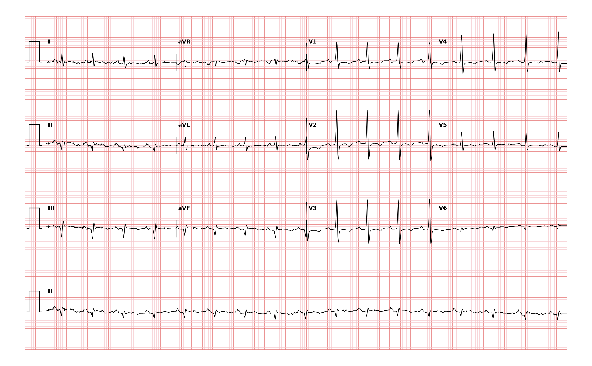

## 문제
61세 남자가 건강검진 심전도에서 이상이 있다는 말을 듣고 왔다. 1년 전 명치가 답답하고 식은땀이 나서 하루 동안 참은 적이 있으나 지금은 가슴 통증이나 숨참이 없다. 당뇨병으로 메트포르민을 먹고 있고 다른 약은 먹지 않는다. 혈압 132/80 mmHg, 맥박 100회/분이다. 고감도 트로포닌 I 는 3시간 간격으로 2회 모두 참고치 이내이다. LDL 콜레스테롤은 142 mg/dL 이다. 심초음파에서 하벽과 후벽의 운동이 감소되어 있고 좌심실 박출률은 50 % 이다. 12유도 심전도는 그림과 같다. 가장 적절한 처치는?

- A. 와파린 투여
- B. 아스피린과 고강도 스타틴 투여
- C. 응급 관상동맥중재술
- D. 혈전용해제 투여
- E. 영구 심박동기 삽입

_12유도 심전도, 25 mm/s · 10 mm/mV, 3×4 + II 리듬 스트립 (PTB-XL ECG dataset, PhysioNet, CC BY 4.0 — 원신호 그대로 작도)_

## 정답 및 해설
> 정답: B

- **정답 핵심**: V1·V2 에 <b>R 이 S 보다 큰 키 큰 R파와 양성 T파</b>가 있고 <b>V1~V3 에 ST 하강이 없으며</b>, III 에 <b>깊은 Q파</b>가 있다 — 후벽 경색의 거울상(후벽의 Q파가 앞쪽 유도에서 큰 R 로 보임)과 하벽 경색이 <b>오래된 것</b>이다. 증상이 없고 <b>트로포닌 2회 정상</b>, 심초음파의 하벽·후벽 운동 감소가 1년 전 「참고 넘긴」 경색과 맞는다. 급성이 아니므로 재관류가 아니라 <b>이차 예방 — 아스피린과 고강도 스타틴</b>을 시작한다.
- **원리**: <b>후벽 경색은 거울로 본다</b>: 표준 12유도에는 좌심실 뒤쪽 벽을 직접 보는 유도가 없다. V1·V2 는 후벽을 정반대 방향에서 보므로, 후벽의 Q파는 V1·V2 에서 큰 R 로, 급성기의 ST 상승은 ST 하강으로, 오래된 뒤의 T 역위는 양성 T 로 뒤집혀 보인다. 오른쪽 관상동맥이나 좌회선지가 막히면 하벽과 후벽이 함께 경색된다.  <b>급성과 오래된 것을 가르는 것</b>: 급성 후벽 경색이면 V1~V3 에 수평 ST 하강이 있고 트로포닌이 오른다 — 이때는 ST 상승 경색과 같이 응급 재관류 대상이다. ST 하강 없이 R 파만 남고 트로포닌이 정상이면 이미 흉터가 된 경색이다.  <b>이차 예방이 첫 처치인 이유</b>: 경색을 겪은 환자는 재경색·사망 위험이 높고, 아스피린(혈소판 억제)과 고강도 스타틴(LDL 낮춤·죽상판 안정)이 이 위험을 줄인다. 그 뒤 베타차단제·ACE 억제제, 허혈 평가, 당뇨병 조절을 더한다.
- **비교**: <table><thead><tr><th style="width:24%">구분</th><th style="width:38%">오래된 하벽·후벽 경색 — 정답(이차 예방)</th><th>급성 후벽 경색 — 가장 가까운 오답(응급 중재술)</th></tr></thead><tbody> <tr><td>V1~V3 ST</td><td><b>하강 없음</b>, 큰 R 과 양성 T</td><td>수평 ST 하강(후벽 ST 상승의 거울상)</td></tr> <tr><td>증상</td><td><b>없음</b>(1년 전 사건)</td><td>지금 진행 중인 흉통</td></tr> <tr><td>트로포닌</td><td><b>2회 정상</b></td><td>상승</td></tr> </tbody></table> V1·V2 의 큰 R 을 보면 ST 를 본다. ST 하강과 흉통·트로포닌 상승이 있으면 급성(재관류), 없으면 오래된 경색(이차 예방)이다.
- **오답 이유**:
  - ① 와파린은 심방세동이나 좌심실 혈전이 함께 있을 때 정답이 된다 — 리듬은 규칙적이고 혈전 소견이 없다.
  - ③ 응급 관상동맥중재술은 지금 흉통이 있고 V1~V3 에 수평 ST 하강과 트로포닌 상승이 있는 급성 후벽 경색이라면 정답이 된다.
  - ④ 혈전용해제는 증상 시작 12시간 이내의 ST 상승 경색에서 120분 안에 중재술을 할 수 없을 때 정답이 된다.
  - ⑤ 영구 심박동기는 하벽 경색 뒤 증상이 있는 고도 방실차단이 지속된다면 정답이 된다 — 여기서는 PR·전도가 정상이다.
- **함정**: V1·V2 의 큰 R 을 급성 후벽 경색으로 읽어 응급 중재술을 고르는 것 — ST 하강도 증상도 트로포닌 상승도 없다.
- **학습목표**: V1·V2 의 큰 R 과 양성 T, ST 하강 없음, 하벽 Q파를 오래된 하벽·후벽 경색으로 판독하고, 증상과 트로포닌이 없으면 응급 재관류가 아니라 이차 예방(아스피린·고강도 스타틴)을 시작한다
- **근거·출처**: Loscalzo J, Fauci AS, Kasper DL, et al., eds. Harrison's Principles of Internal Medicine, 22nd ed. McGraw Hill; 2025. Chapter 247: Electrocardiography · Loscalzo J, Fauci AS, Kasper DL, et al., eds. Harrison's Principles of Internal Medicine, 22nd ed. McGraw Hill; 2025. Chapter 284: Ischemic Heart Disease · Wagner P, Strodthoff N, Bousseljot RD, et al. PTB-XL, a large publicly available electrocardiography dataset. Sci Data. 2020;7:154

## 출처
- PTB-XL ECG dataset v1.0.3 (PhysioNet, CC BY 4.0) · record 12173 · Creative Commons Attribution 4.0 International · https://physionet.org/content/ptb-xl/1.0.3/LICENSE.txt
